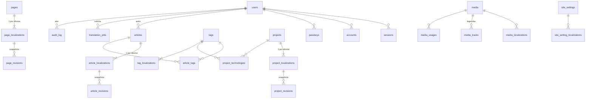
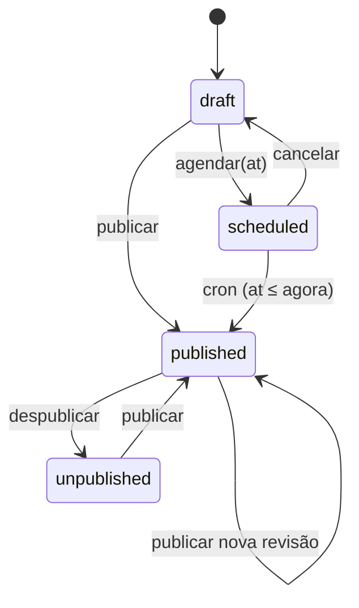
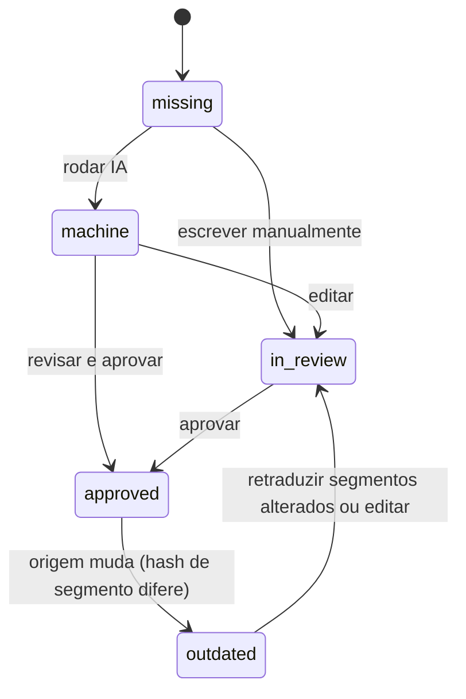

# Modelo de dados

Banco: Cloudflare D1 (SQLite) via Drizzle. Convenções em [ADR-0004](adr/0004-dados-d1-drizzle.md):
- **Nomes e IDs:** snake_case, IDs UUIDv7 em texto.
- **Datas:** timestamps em ms (UTC).
- **JSON:** validado por zod.
- **Exclusão:** lógica, via `deleted_at`.

Este documento é a especificação. O código fica em `server/db/schema/*.ts`, criado a partir da F02-T1.

## 1. Visão geral (ERD)



Tabelas sem relação forte: `redirects`, `contact_messages`, `glossary_terms`.

## 2. Enums compartilhados (`shared/`)

| Enum | Valores |
|---|---|
| `Locale` | `pt-BR` (origem), `en`, `es`, `de`, `fr` |
| `PublicationStatus` | `draft`, `scheduled`, `published`, `unpublished` |
| `TranslationState` | `source` (só pt-BR), `missing`, `machine`, `in_review`, `approved`, `outdated` |
| `RevisionKind` | `autosave`, `manual`, `publish`, `restore`, `ai` |
| `Role` | `owner`, `admin`, `editor`, `author`, `translator`, `viewer` |
| `MediaKind` / `MediaStatus` | `image`, `video`, `file` / `pending`, `ready`, `deleted` |
| `TagKind` | `topic`, `technology` |
| `PageKey` | `home`, `about`, `contact`, `privacy`, `blog`, `projects` |

## 3. Autenticação (geradas pelo CLI do Better Auth)

Os modelos do Better Auth são mapeados para nomes no plural (`modelName`), para seguir a convenção.

| Tabela | Colunas principais | Notas |
|---|---|---|
| `users` | `id`, `name`, `email` (único), `email_verified`, `image`, `role` (`Role`, padrão `viewer`), `banned`, `ban_reason`, `ban_expires`, `created_at`, `updated_at` | Campos `role`/`ban*` vêm do plugin `admin` |
| `sessions` | `id`, `user_id` → users, `token` (único), `expires_at`, `ip_address`, `user_agent`, `impersonated_by`, `created_at`, `updated_at` | `ip_address` é sempre `NULL`: o rastreamento de IP do Better Auth fica desligado e um hook grava `NULL` (decisão da F03-T1). Índice em `user_id` |
| `accounts` | `id`, `user_id` → users, `provider_id` (`github`), `account_id` (ID numérico do GitHub), colunas de tokens OAuth, `password` (sem uso), `created_at`, `updated_at` | Os tokens OAuth são **descartados** antes de chegar ao banco (hooks de criação e de atualização; decisão da F03-T1). `(provider_id, account_id)` é único |
| `verifications` | `id`, `identifier`, `value`, `expires_at`, `created_at`, `updated_at` | Uso interno do Better Auth. Índice em `identifier` |
| `passkeys` | `id`, `name`, `public_key`, `user_id` → users, `credential_id`, `counter`, `device_type`, `backed_up`, `transports`, `aaguid`, `created_at` | Plugin `@better-auth/passkey`; migração `0002_passkeys` (F03-T2), com `credential_id` único e FK em cascata |

## 4. Conteúdo

O mesmo padrão vale para artigos, projetos e páginas:
- **entidade:** campos que não dependem de idioma;
- **localização:** uma linha por idioma, com a cópia de trabalho e o snapshot publicado desnormalizado para leitura rápida;
- **revisões:** histórico imutável, com snapshot comprimido.

### 4.1 `articles`

| Coluna | Tipo | Notas |
|---|---|---|
| `id` | text PK | UUIDv7 |
| `author_id` | text → users | |
| `featured` | boolean | Destaque na home |
| `cover_media_id` | text → media, nulo | Cópia de trabalho (vale no público só depois de publicar) |
| `draft_tag_ids` | json `string[]` | Temas na cópia de trabalho |
| `first_published_at` | timestamp, nulo | Primeira publicação de qualquer idioma |
| `created_at`, `updated_at`, `created_by`, `updated_by`, `deleted_at` | | Auditoria e exclusão lógica |

### 4.2 `article_localizations`

| Coluna | Tipo | Notas |
|---|---|---|
| `id` | text PK | |
| `article_id` | text → articles | |
| `locale` | `Locale` | |
| `title`, `slug`, `excerpt` | text | Cópia de trabalho |
| `body` | json (documento) | Validado pelo `document-schema` ([ADR-0006](adr/0006-conteudo-e-editor.md)) |
| `seo_title`, `seo_description` | text, nulo | Com fallback para `title`/`excerpt` |
| `og_image_media_id` | text → media, nulo | Gerada no admin ou escolhida |
| `noindex` | boolean | |
| `word_count`, `reading_time_min` | integer | Derivados no servidor |
| `toc` | json | Derivado (headings h2–h3 com `id`) |
| `status` | `PublicationStatus` | |
| `scheduled_at` | timestamp, nulo | Obrigatório quando `status = scheduled` |
| `published_revision_id` | text → article_revisions, nulo | Ponteiro da versão no ar |
| `published_snapshot` | json, nulo | Cópia **não comprimida** da revisão publicada (leitura pública em uma query) |
| `published_slug`, `published_title`, `published_excerpt`, `published_cover_media_id`, `published_reading_time_min` | nulo | Desnormalizados para listas, alternates e sitemap |
| `published_at` | timestamp, nulo | Quando a versão atual entrou no ar |
| `translation_state` | `TranslationState` | `source` para pt-BR |
| `source_revision_id` | text → article_revisions, nulo | Revisão pt-BR usada como origem da tradução |
| `segments_meta` | json | `{ [segmentId]: { sourceHash, state } }` para detectar desatualização |
| `reviewed_by`, `reviewed_at` | nulo | Última aprovação humana |
| `version` | integer | Concorrência otimista (incrementa a cada gravação) |
| `working_hash` | text | SHA-256 da cópia de trabalho canônica (indica "alterações não publicadas") |
| `created_at`, `updated_at`, `updated_by`, `deleted_at` | | |

**Índices:**
- `UNIQUE(article_id, locale)`;
- `UNIQUE(locale, slug) WHERE deleted_at IS NULL`;
- `UNIQUE(locale, published_slug) WHERE published_slug IS NOT NULL`;
- `(locale, published_at DESC, id DESC) WHERE published_revision_id IS NOT NULL`;
- `(status, scheduled_at)`.

### 4.3 `article_revisions`

| Coluna | Tipo | Notas |
|---|---|---|
| `id` | text PK | |
| `localization_id` | text → article_localizations | |
| `article_id`, `locale` | | Redundantes para consultas |
| `number` | integer | Monotônico por localização |
| `kind` | `RevisionKind` | |
| `snapshot_gz` | blob | JSON canônico comprimido (gzip via `CompressionStream`): campos localizados + campos da entidade no momento (capa, temas) |
| `content_hash` | text | SHA-256 do JSON canônico; autosave idêntico ao anterior não gera revisão |
| `note` | text, nulo | Mensagem opcional (revisões manuais) |
| `created_by`, `created_at` | | |

**Índices:** `UNIQUE(localization_id, number)`; `(localization_id, created_at DESC)`.

**Retenção:** `manual`, `publish`, `restore` e `ai` são permanentes. Para `autosave`, ficam no máximo as 10 mais recentes por localização, e nenhuma com mais de 14 dias; a poda é feita pelo cron (§4.10). Um autosave apontado como publicado ou como origem de tradução nunca é podado.

### 4.4 Temas na versão publicada: `article_tags`

`article_tags(article_id, tag_id, PRIMARY KEY(article_id, tag_id))` reflete os temas **publicados**. É atualizada ao publicar a localização pt-BR, a partir de `draft_tag_ids`.

### 4.5 Projetos: `projects`, `project_localizations`, `project_revisions`, `project_technologies`

`projects` tem:
- `sort_order`, `featured`, `cover_media_id`;
- `gallery_media_ids` (json), `draft_technology_ids` (json);
- `period_start` / `period_end` (`YYYY-MM`), `repo_url`, `demo_url` (validados como `https:`);
- os campos de auditoria.

`project_localizations` segue o mesmo padrão de `article_localizations`, com estes campos específicos:
- `summary` (texto curto) e `role` (papel no projeto);
- `body`: narrativa do estudo de caso. O editor sugere as seções H2 Contexto, Desafio, Solução e Resultados;
- `highlights` (json `{ label, value, note? }[]`): resultados **verificáveis**. Nunca preencher com métricas inventadas.

`project_revisions` é idêntica a `article_revisions`. `project_technologies(project_id, tag_id, position)` reflete as tecnologias publicadas (tags `technology`), na ordem escolhida.

Desde a F07-T1: o autor de um projeto, para as permissões 🟡, é o `created_by`; `sort_order` é a posição na ordem manual (0 = primeiro), regravada para a lista inteira num `db.batch`; `featured` marca o destaque na home (quantos aparecem é configuração da F08); a galeria registra usos `gallery` em `media_usages`.

### 4.6 Páginas: `pages`, `page_localizations`, `page_revisions`

- `pages(id, key PageKey UNIQUE, created_at, updated_at)`.
- `page_localizations`: mesmo padrão, mas **sem slug**, porque o caminho é definido nas rotas i18n.
  - O conteúdo fica em `blocks` (json), validado por um schema zod **por `PageKey`**:
    - `home`: hero (eyebrow, título, subtítulo, CTA), seções narrativas, destaques e CTA final;
    - `about`: introdução (documento), linha do tempo, competências, links;
    - `contact`: introdução e textos do formulário;
    - `privacy`: corpo (documento) e data de atualização;
    - `blog` e `projects`: título, introdução e SEO dos índices.
- `page_revisions`: idêntica às demais.

Desde a F08-T2, os schemas ficam em `shared/pages/blocks.ts`. Uma página e a sua cópia pt-BR são criadas na primeira necessidade (`getPage`), com os blocos vazios. `entity` do snapshot de página é `{}`; publicar e despublicar seguem os batches protegidos dos artigos, sem colunas `published_*` próprias (o público lê o `published_snapshot`).

### 4.7 Taxonomia: `tags`, `tag_localizations`

| Tabela | Colunas | Índices |
|---|---|---|
| `tags` | `id`, `kind` (`TagKind`), `url` (site oficial da tecnologia, nulo), `icon_key` (ícone versionado no repositório, nulo), auditoria | |
| `tag_localizations` | `tag_id`, `locale`, `name`, `slug`, `description`, `translation_state`, `updated_at` | `PK(tag_id, locale)`, `UNIQUE(locale, slug)` |

### 4.8 Decisões da F05-T1

- **Código:** `server/db/schema/content.ts` e `taxonomy.ts`, migração `0004_content`. As três famílias (artigo, projeto, página) compartilham grupos de colunas, e um registro (`server/services/content/content-tables.ts`) permite que os repositórios de localização e de revisão sejam escritos uma vez.
- **Colunas de projeto:** `project_localizations` tem `published_summary` no lugar de `published_excerpt`; as listas públicas expõem os dois como `lead`. Projetos também têm `word_count`, `reading_time_min` e `toc`, pelo mesmo padrão dos artigos.
- **Páginas:** `page_localizations` não tem título, slug, palavras nem sumário; só `blocks`, SEO e as colunas de publicação. `published_snapshot` basta para a leitura pública.
- **Snapshot:** `{ entity, localization }` (`shared/content/snapshot.ts`, zod `strict`). Artigo: capa e temas + título, slug, resumo, corpo e SEO. Projeto: capa, galeria, tecnologias, período e URLs + título, slug, resumo, papel, corpo, destaques e SEO. Página: só `blocks` e SEO. `working_hash` é o hash do snapshot da cópia de trabalho, o mesmo de uma revisão com aquele conteúdo.
- **Schemas provisórios:** `body` só valida a forma externa do documento (`type: 'doc'`) até a F05-T2; `blocks` aceita qualquer JSON até os schemas por `PageKey` da F08.
- **Deduplicação:** `autosave` idêntico à revisão **mais recente** não gera linha (a função devolve a existente). `publish`, `restore` e `ai` sempre geram, porque registram um evento. A regra de `manual` mudou na F06-T2 (§4.10).
- **Número da revisão:** calculado no próprio `INSERT` (subconsulta `max + 1`), com `UNIQUE(localization_id, number)` como rede.
- **FK circular:** `published_revision_id`/`source_revision_id` → revisões e `localization_id` → localizações; o SQLite aceita, e revisões publicadas nunca são podadas.
- **CHECKs:** `translation_state = 'source'` ⇔ `locale = 'pt-BR'`; `status = 'scheduled'` exige `scheduled_at`; `published_revision_id`, `published_snapshot` e `published_slug` são nulos juntos; período `YYYY-MM` e URLs `https:` em projetos e temas.
- **Cursor das listas:** `base64url("{published_at}:{id}")` (`shared/content/cursor.ts`), com o `id` como desempate de `published_at` repetido.

### 4.9 Decisões da F06-T1

- **Criar:** só com o título (decisão 4); o artigo nasce `draft` com a localização pt-BR, corpo vazio (`content: []`) e o slug do título (`shared/utils/slugify.ts`), com `-2`, `-3`… quando ocupado. Sem letra ou número no título, o slug é `artigo`. A busca de slugs ocupados usa uma faixa (`slug = base` ou entre `base-` e `base.`), porque o D1 recusa padrões de `LIKE` com mais de 50 bytes.
- **Salvar:** um `db.batch` (`saveArticleStatements`). A cópia de trabalho é atualizada só se a `version` for a lida (concorrência otimista); a entidade (capa, `draft_tag_ids`, `featured`) e os `media_usages` do artigo (substituídos inteiros: corpo, galeria e poster por idioma, capa sem idioma, OG por idioma) só mudam se a cópia agora tem `version + 1` e o `working_hash` desta gravação. Uma gravação desatualizada não muda nada e responde 409 com `path: "version"`.
- **Validação ao salvar:** corpo pelo `document-schema`; capa e imagem de OG precisam ser imagens prontas; toda mídia citada no corpo precisa existir (qualquer status não excluído); temas precisam existir e ser `topic`; até 12 temas.
- **Excluir:** lógico, na entidade e nas localizações, e os `media_usages` do artigo saem; o slug fica livre (índice parcial). Com uma localização publicada, 409 até despublicar (F06-T4, decisão 2).
- **Temas:** `topic` com nome e slug em pt-BR; os usos contam artigos não excluídos com o tema em `draft_tag_ids` ou em `article_tags`. Um tema em uso não pode ser excluído (409 com a contagem, decisão 3).
- **Âncoras:** os títulos usam a mesma transliteração dos slugs (`anchorSlug` chama `slugify`, decisão 5).

### 4.10 Decisões da F06-T2

- **Autosave:** o salvamento da cópia de trabalho (PATCH) grava também uma revisão `autosave` no mesmo `db.batch`, com a mesma guarda de versão (só entra se a cópia foi atualizada) e sem repetir a revisão mais recente. O hash da revisão é o `working_hash`.
- **`manual` (decisão 3):** deduplica só contra a última `manual` com o mesmo conteúdo **e a mesma nota**. Uma versão nomeada é gravada mesmo quando um autosave já guarda aquele conteúdo; antes, a nota se perdia.
- **Comandos em batch:** `prepareRevision` faz o gzip e o hash fora do batch (o `CompressionStream` é assíncrono) e `insertRevisionStatement` é um `INSERT … SELECT` com a guarda, a regra de repetição e o número calculado no próprio comando.
- **Restaurar:** copia título, slug, resumo, corpo, SEO, capa e temas da revisão para a cópia de trabalho, recalcula derivados e usos de mídia e grava uma revisão `restore`, tudo num batch guardado pela versão; nenhuma revisão é apagada. Temas excluídos depois da revisão ficam de fora; um slug que outro artigo tomou dá 409 em `slug`.
- **Poda:** `pruneAutosaves` apaga, por tipo de conteúdo, autosaves além dos 10 mais recentes da localização (`row_number()` por `localization_id`) ou com mais de 14 dias, menos os apontados por `published_revision_id`/`source_revision_id`, até 500 por execução. A tarefa `content:prune-autosaves` roda no cron de 5 em 5 minutos (environments.md) e só age na janela de 03:00 a 03:05 UTC (`isPruneWindow`), uma vez por dia.

### 4.11 Decisões da F06-T4

- **Publicar:** um `db.batch` (`publishing.repo.ts`): a revisão `publish` primeiro (o ponteiro tem FK para ela); a localização (status, `published_*`, `published_snapshot`, `published_at`, sem `scheduled_at`) só se ainda tem a `version` e o status lidos; e, só se a localização agora aponta para a revisão nova, `first_published_at`, `article_tags` (pt-BR, a partir de `draft_tag_ids`), os redirects e a linha de `audit_log`. Uma falha em qualquer comando desfaz tudo (testado com um `published_slug` que outro artigo usa). Publicar não muda a `version` da cópia de trabalho, então um editor aberto não entra em conflito.
- **Guardas:** uma tradução só publica `approved` (`outdated` bloqueia) e com a pt-BR publicada (publicar as duas juntas fica para a F09); imagens informativas (capa, imagens do corpo sem `altOverride`, itens de galeria) precisam de `alt` no idioma ou no pt-BR, e mídia indisponível bloqueia (decisão 3).
- **Redirects:** quando o `published_slug` muda, `redirects` recebe o caminho antigo → o novo (`/blog/{slug}` ou `/{l}/blog/{slug}`, `shared/content/paths.ts`). O que apontava para o caminho antigo passa a apontar para o novo (sem cadeias) e um redirect a partir do caminho novo é removido (sem laços). O middleware `server/middleware/redirects.ts` só consulta o D1 para caminhos de artigo e responde 301 com cache público e a tag `redirects`.
- **Despublicar:** limpa as colunas publicadas (as revisões ficam); a pt-BR leva as traduções publicadas junto e apaga `article_tags` (decisão 4).
- **Agendar:** de `draft` ou `unpublished`, para um instante futuro de até 1 ano; cancelar volta a `draft`. O instante é digitado no fuso do site (Q-06: `America/Sao_Paulo`) e guardado em UTC.
- **Cron `content:publish-due`:** no trigger de 5 minutos, até 10 localizações vencidas por execução, publicando o texto do momento (decisão 2), só enquanto ainda estão `scheduled` (idempotente). Uma que falha numa guarda volta a `draft` com `article.schedule_failed` na auditoria; uma desatualizada (salva no meio) tenta de novo na execução seguinte.
- **Purge:** depois do batch, com as tags de `shared/cache/purge.ts` (ADR-0003 §3); falhar o purge não desfaz a publicação (fica no log).

## 5. Mídia

| Tabela | Colunas | Notas |
|---|---|---|
| `media` | `id`, `kind`, `status`, `mime_type`, `original_filename`, `size_bytes`, `width`, `height`, `duration_ms`, `sha256` (único, inclusive entre apagados), `original_key`, `variants` (json `{ name, format, width, height, key, size }[]`), `placeholder_data_url`, `dominant_color`, `focal_x`/`focal_y` (0–1, `CHECK`), `decorative` (alt vazio explícito, F04-T1), `poster_media_id` (vídeo), `created_by`, `updated_by`, `created_at`, `updated_at`, `deleted_at` | [ADR-0007](adr/0007-midia.md); migração `0003_media` |
| `media_localizations` | `media_id`, `locale`, `alt`, `caption`, `credit`, `translation_state`, `updated_at` | `PK(media_id, locale)`; `alt` obrigatório para imagens informativas (vazio só se decorativa, marcada explicitamente) |
| `media_tracks` | `id`, `media_id`, `locale`, `kind` (`captions`/`subtitles`), `key`, `label`, `size` | Legendas WebVTT de vídeo, registradas com o manifesto; únicas por `(media_id, locale, kind)` |
| `media_usages` | `media_id`, `entity_type`, `entity_id`, `locale` (nulo), `context` (`body`, `cover`, `og`, `gallery`, `poster`, `settings`) | Sem chave única (um `locale` nulo não seria único): as linhas de uma entidade são trocadas por inteiro a cada gravação e publicação; índices em `media_id` e na entidade; impede exclusão de mídia em uso |

## 6. Configurações e sistema

| Tabela | Colunas | Notas |
|---|---|---|
| `site_settings` | `key` PK (`identity`, `social`, `contact`, `seo_defaults`, `navigation`, `footer`, `ai_translation`, `features`), `value` json, `version`, `updated_by`, `updated_at` | Um schema zod por chave em `shared/settings/` |
| `site_setting_localizations` | `key`, `locale`, `value` json, `translation_state`, `updated_at` | `PK(key, locale)`; partes traduzíveis (cargo, bio, modelo de título, rótulos de navegação, rodapé) |
| `redirects` | `id`, `from_path` (único), `to_path`, `status_code` (301/302/308), `locale`, `entity_type`, `entity_id` (nulo se manual), `created_by`, `created_at` | Criado automaticamente quando um slug publicado muda |
| `contact_messages` | `id`, `name`, `email`, `message`, `locale`, `status` (`new`/`read`/`archived`/`spam`), `ip_hash`, `created_at`, `read_at` | Retenção de 12 meses (`contact:retention`, diária). Sem `deleted_at`: excluir no admin apaga a linha de vez, por serem dados pessoais (F08-T3, migração 0005) |
| `audit_log` | `id`, `actor_user_id` (nulo = sistema), `action` (`article.publish`, `auth.login_failed`…), `entity_type`, `entity_id`, `locale`, `metadata` json (sem segredos nem PII), `ip_hash`, `created_at` | Índices `(created_at DESC)`, `(entity_type, entity_id)`; retenção de 12 meses |

Desde a F08-T1, os schemas ficam em `shared/settings/schemas.ts`: cada chave tem uma parte global (`site_settings.value`), uma parte por idioma quando é traduzível (`identity`: cargo e bio; `seo_defaults`: modelo de título e descrição; `footer`: texto), padrões e a marca de pública. A leitura pública resolve o idioma, depois o pt-BR, depois o padrão; um valor salvo que não passe mais no schema é lido como o padrão. Um salvamento grava a parte global com a versão lida e os idiomas alterados num `db.batch` (o texto escrito pelo owner num idioma fica `approved`).

### `site_settings.ai_translation` (exemplo do schema)

```ts
{
  enabled: boolean,
  provider: 'workers-ai',            // 'anthropic' só após ADR + aprovação
  model: string,                     // definido na F09-T3
  dailyNeuronCap: number,            // padrão 8000
  monthlyBudgetMicroUsd: number,     // padrão 0
  perJobMaxMicroUsd: number,
  style: Record<'en'|'es'|'de'|'fr', { formality: 'formal'|'informal', notes?: string }>
}
```

## 7. Tradução

| Tabela | Colunas | Notas |
|---|---|---|
| `translation_jobs` | `id`, `entity_type`, `entity_id`, `target_locale`, `source_revision_id`, `provider`, `model`, `status` (`estimated`/`running`/`succeeded`/`failed`/`cancelled`), `segments_total`, `segments_done`, `estimated_input_tokens`, `estimated_output_tokens`, `estimated_neurons`, `estimated_cost_micro_usd`, `input_tokens`, `output_tokens`, `neurons`, `cost_micro_usd`, `usage_estimated` (boolean: o provedor não informou o uso real), `error` (sanitizado), `requested_by`, `created_at`, `started_at`, `finished_at` | Ledger de uso: as somas por dia UTC e por mês alimentam o guarda de custo |
| `glossary_terms` | `id`, `term` (pt-BR), `locale` (nulo = todos), `translation` (nulo), `do_not_translate`, `case_sensitive`, `note`, auditoria | Aplicado no prompt e na proteção de segmentos |

## 8. Máquinas de estado

### Publicação (por localização)



**Guardas:**
- Uma localização ≠ pt-BR só publica com `translation_state = approved` **e** com a localização pt-BR publicada (ou sendo publicada junto).
- `outdated` bloqueia a publicação até revisar.
- Publicar exige a permissão `*:publish`; agendar exige `*:schedule`.

### Tradução (por localização ≠ pt-BR)



A comparação usa `segments_meta[segmentId].sourceHash` contra os hashes da última revisão pt-BR.

## 9. Invariantes (cobertas por testes)

1. `(locale, slug)` é único por tipo de conteúdo entre registros não excluídos; `(locale, published_slug)` é único entre publicados.
2. Revisões nunca são alteradas nem apagadas, exceto pela poda de `autosave`.
3. O público lê **somente** `published_snapshot` e as colunas `published_*`; nunca a cópia de trabalho.
4. Toda mudança de `published_slug` cria um `redirects` do caminho antigo para o novo.
5. Mídia com linha em `media_usages` não pode ir para `deleted`.
6. Escritas que envolvem mais de uma tabela (publicar, restaurar, aprovar) usam `db.batch` (atômico).
7. `translation_jobs` só registra execuções que passaram pelo guarda de custo.
8. Nenhuma coluna guarda segredo em texto claro. IPs são sempre HMAC.

## 10. Consultas públicas de referência

| Página | Consulta |
|---|---|
| Artigo | `article_localizations` por `(locale, published_slug)` → `published_snapshot` (1 query) + alternates `SELECT locale, published_slug FROM article_localizations WHERE article_id = ? AND published_revision_id IS NOT NULL` |
| Lista do blog | `WHERE locale = ? AND published_revision_id IS NOT NULL AND deleted_at IS NULL ORDER BY published_at DESC, id DESC LIMIT 12` (cursor) + capas em `media` (1 query `IN`) |
| Tema | `article_tags` ⋈ localizações publicadas do idioma |
| Sitemap | Localizações publicadas agrupadas por entidade (alternates + `published_at`) |

Meta: no máximo 4 queries por página pública em cache-miss, sempre usando índices.

## 11. Estimativa de tamanho (Free: 500 MB por banco)

| Item | Estimativa |
|---|---|
| Artigo (5 idiomas: cópia + publicado ~50 KB/idioma; ~35 revisões comprimidas ~4 KB cada) | ≈ 1 MB |
| 100 artigos + 30 projetos + páginas | ≈ 140 MB |
| Auth, mídia (metadados), logs (12 meses) | ≈ 20–40 MB |

Alertas:
- Acima de 300 MB, o `/release-check` sinaliza.
- Se chegar a esse ponto, um ADR novo move os snapshots de revisão para o R2.
