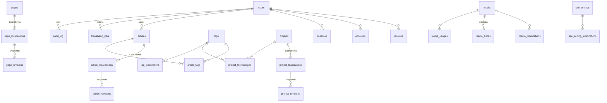
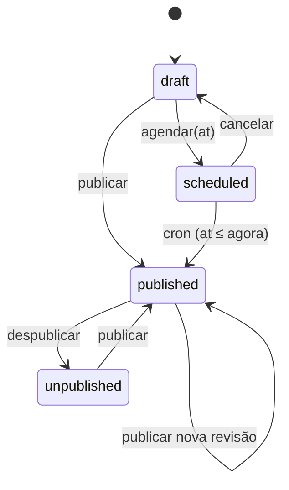
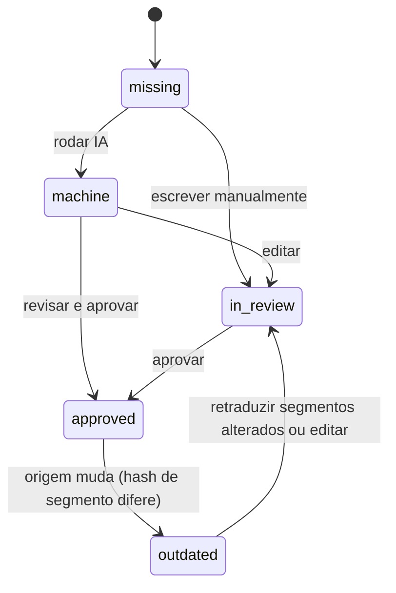

# Modelo de dados

Banco: Cloudflare D1 (SQLite) via Drizzle. Convenções em [ADR-0004](adr/0004-dados-d1-drizzle.md):
- **Nomes e IDs:** snake_case, IDs UUIDv7 em texto.
- **Datas:** timestamps em ms (UTC).
- **JSON:** validado por zod.
- **Exclusão:** lógica, via `deleted_at`.

Este documento é a especificação. O código fica em `server/db/schema/*.ts`, criado a partir da F02-T1.

## 1. Visão geral (ERD)



Tabelas sem relação forte: `redirects`, `contact_messages`, `glossary_terms`.

## 2. Enums compartilhados (`shared/`)

| Enum | Valores |
|---|---|
| `Locale` | `pt-BR` (origem), `en`, `es`, `de`, `fr` |
| `PublicationStatus` | `draft`, `scheduled`, `published`, `unpublished` |
| `TranslationState` | `source` (só pt-BR), `missing`, `machine`, `in_review`, `approved`, `outdated` |
| `RevisionKind` | `autosave`, `manual`, `publish`, `restore`, `ai` |
| `Role` | `owner`, `admin`, `editor`, `author`, `translator`, `viewer` |
| `MediaKind` / `MediaStatus` | `image`, `video`, `file` / `pending`, `ready`, `deleted` |
| `TagKind` | `topic`, `technology` |
| `PageKey` | `home`, `about`, `contact`, `privacy`, `blog`, `projects` |

## 3. Autenticação (geradas pelo CLI do Better Auth)

Os modelos do Better Auth são mapeados para nomes no plural (`modelName`), para seguir a convenção.

| Tabela | Colunas principais | Notas |
|---|---|---|
| `users` | `id`, `name`, `email` (único), `email_verified`, `image`, `role` (`Role`, padrão `viewer`), `banned`, `ban_reason`, `ban_expires`, `created_at`, `updated_at` | Campos `role`/`ban*` vêm do plugin `admin` |
| `sessions` | `id`, `user_id` → users, `token` (único), `expires_at`, `ip_address`, `user_agent`, `created_at`, `updated_at` | F03-T1: desligar o rastreamento de IP do Better Auth ou gravar só o hash |
| `accounts` | `id`, `user_id` → users, `provider_id` (`github`), `account_id` (ID numérico do GitHub), tokens OAuth, `created_at`, `updated_at` | F03-T1: avaliar criptografia ou descarte dos tokens OAuth (não precisamos deles depois do login) |
| `verifications` | `id`, `identifier`, `value`, `expires_at` | Uso interno do Better Auth |
| `passkeys` | `id`, `name`, `public_key`, `user_id` → users, `credential_id`, `counter`, `device_type`, `backed_up`, `transports`, `aaguid`, `created_at` | Plugin `@better-auth/passkey` |

## 4. Conteúdo

O mesmo padrão vale para artigos, projetos e páginas:
- **entidade:** campos que não dependem de idioma;
- **localização:** uma linha por idioma, com a cópia de trabalho e o snapshot publicado desnormalizado para leitura rápida;
- **revisões:** histórico imutável, com snapshot comprimido.

### 4.1 `articles`

| Coluna | Tipo | Notas |
|---|---|---|
| `id` | text PK | UUIDv7 |
| `author_id` | text → users | |
| `featured` | boolean | Destaque na home |
| `cover_media_id` | text → media, nulo | Cópia de trabalho (vale no público só depois de publicar) |
| `draft_tag_ids` | json `string[]` | Temas na cópia de trabalho |
| `first_published_at` | timestamp, nulo | Primeira publicação de qualquer idioma |
| `created_at`, `updated_at`, `created_by`, `updated_by`, `deleted_at` | | Auditoria e exclusão lógica |

### 4.2 `article_localizations`

| Coluna | Tipo | Notas |
|---|---|---|
| `id` | text PK | |
| `article_id` | text → articles | |
| `locale` | `Locale` | |
| `title`, `slug`, `excerpt` | text | Cópia de trabalho |
| `body` | json (documento) | Validado pelo `document-schema` ([ADR-0006](adr/0006-conteudo-e-editor.md)) |
| `seo_title`, `seo_description` | text, nulo | Com fallback para `title`/`excerpt` |
| `og_image_media_id` | text → media, nulo | Gerada no admin ou escolhida |
| `noindex` | boolean | |
| `word_count`, `reading_time_min` | integer | Derivados no servidor |
| `toc` | json | Derivado (headings h2–h3 com `id`) |
| `status` | `PublicationStatus` | |
| `scheduled_at` | timestamp, nulo | Obrigatório quando `status = scheduled` |
| `published_revision_id` | text → article_revisions, nulo | Ponteiro da versão no ar |
| `published_snapshot` | json, nulo | Cópia **não comprimida** da revisão publicada (leitura pública em uma query) |
| `published_slug`, `published_title`, `published_excerpt`, `published_cover_media_id`, `published_reading_time_min` | nulo | Desnormalizados para listas, alternates e sitemap |
| `published_at` | timestamp, nulo | Quando a versão atual entrou no ar |
| `translation_state` | `TranslationState` | `source` para pt-BR |
| `source_revision_id` | text → article_revisions, nulo | Revisão pt-BR usada como origem da tradução |
| `segments_meta` | json | `{ [segmentId]: { sourceHash, state } }` para detectar desatualização |
| `reviewed_by`, `reviewed_at` | nulo | Última aprovação humana |
| `version` | integer | Concorrência otimista (incrementa a cada gravação) |
| `working_hash` | text | SHA-256 da cópia de trabalho canônica (indica "alterações não publicadas") |
| `created_at`, `updated_at`, `updated_by`, `deleted_at` | | |

**Índices:**
- `UNIQUE(article_id, locale)`;
- `UNIQUE(locale, slug) WHERE deleted_at IS NULL`;
- `UNIQUE(locale, published_slug) WHERE published_slug IS NOT NULL`;
- `(locale, published_at DESC, id DESC) WHERE published_revision_id IS NOT NULL`;
- `(status, scheduled_at)`.

### 4.3 `article_revisions`

| Coluna | Tipo | Notas |
|---|---|---|
| `id` | text PK | |
| `localization_id` | text → article_localizations | |
| `article_id`, `locale` | | Redundantes para consultas |
| `number` | integer | Monotônico por localização |
| `kind` | `RevisionKind` | |
| `snapshot_gz` | blob | JSON canônico comprimido (gzip via `CompressionStream`): campos localizados + campos da entidade no momento (capa, temas) |
| `content_hash` | text | SHA-256 do JSON canônico; autosave idêntico ao anterior não gera revisão |
| `note` | text, nulo | Mensagem opcional (revisões manuais) |
| `created_by`, `created_at` | | |

**Índices:** `UNIQUE(localization_id, number)`; `(localization_id, created_at DESC)`.

**Retenção:** `manual`, `publish`, `restore` e `ai` são permanentes. Para `autosave`, ficam no máximo as 10 mais recentes por localização, e nenhuma com mais de 14 dias; a poda é feita pelo cron.

### 4.4 Temas na versão publicada: `article_tags`

`article_tags(article_id, tag_id, PRIMARY KEY(article_id, tag_id))` reflete os temas **publicados**. É atualizada ao publicar a localização pt-BR, a partir de `draft_tag_ids`.

### 4.5 Projetos: `projects`, `project_localizations`, `project_revisions`, `project_technologies`

`projects` tem:
- `sort_order`, `featured`, `cover_media_id`;
- `gallery_media_ids` (json), `draft_technology_ids` (json);
- `period_start` / `period_end` (`YYYY-MM`), `repo_url`, `demo_url` (validados como `https:`);
- os campos de auditoria.

`project_localizations` segue o mesmo padrão de `article_localizations`, com estes campos específicos:
- `summary` (texto curto) e `role` (papel no projeto);
- `body`: narrativa do estudo de caso. O editor sugere as seções H2 Contexto, Desafio, Solução e Resultados;
- `highlights` (json `{ label, value, note? }[]`): resultados **verificáveis**. Nunca preencher com métricas inventadas.

`project_revisions` é idêntica a `article_revisions`. `project_technologies(project_id, tag_id, position)` reflete as tecnologias publicadas (tags `technology`).

### 4.6 Páginas: `pages`, `page_localizations`, `page_revisions`

- `pages(id, key PageKey UNIQUE, created_at, updated_at)`.
- `page_localizations`: mesmo padrão, mas **sem slug**, porque o caminho é definido nas rotas i18n.
  - O conteúdo fica em `blocks` (json), validado por um schema zod **por `PageKey`**:
    - `home`: hero (eyebrow, título, subtítulo, CTA), seções narrativas, destaques e CTA final;
    - `about`: introdução (documento), linha do tempo, competências, links;
    - `contact`: introdução e textos do formulário;
    - `privacy`: corpo (documento) e data de atualização;
    - `blog` e `projects`: título, introdução e SEO dos índices.
- `page_revisions`: idêntica às demais.

### 4.7 Taxonomia: `tags`, `tag_localizations`

| Tabela | Colunas | Índices |
|---|---|---|
| `tags` | `id`, `kind` (`TagKind`), `url` (site oficial da tecnologia, nulo), `icon_key` (ícone versionado no repositório, nulo), auditoria | |
| `tag_localizations` | `tag_id`, `locale`, `name`, `slug`, `description`, `translation_state`, `updated_at` | `PK(tag_id, locale)`, `UNIQUE(locale, slug)` |

## 5. Mídia

| Tabela | Colunas | Notas |
|---|---|---|
| `media` | `id`, `kind`, `status`, `mime_type`, `original_filename`, `size_bytes`, `width`, `height`, `duration_ms`, `sha256` (único), `original_key`, `variants` (json `{ name, format, width, height, key, size }[]`), `placeholder_data_url`, `dominant_color`, `focal_x`/`focal_y` (0–1), `poster_media_id` (vídeo), auditoria | [ADR-0007](adr/0007-midia.md) |
| `media_localizations` | `media_id`, `locale`, `alt`, `caption`, `credit`, `translation_state`, `updated_at` | `PK(media_id, locale)`; `alt` obrigatório para imagens informativas (vazio só se decorativa, marcada explicitamente) |
| `media_tracks` | `id`, `media_id`, `locale`, `kind` (`captions`/`subtitles`), `key`, `label` | Legendas WebVTT de vídeo |
| `media_usages` | `media_id`, `entity_type`, `entity_id`, `locale` (nulo), `context` (`body`, `cover`, `og`, `gallery`, `poster`, `settings`) | PK composta; recalculada a cada gravação e publicação; impede exclusão de mídia em uso |

## 6. Configurações e sistema

| Tabela | Colunas | Notas |
|---|---|---|
| `site_settings` | `key` PK (`identity`, `social`, `contact`, `seo_defaults`, `navigation`, `footer`, `ai_translation`, `features`), `value` json, `version`, `updated_by`, `updated_at` | Um schema zod por chave em `shared/settings/` |
| `site_setting_localizations` | `key`, `locale`, `value` json, `translation_state`, `updated_at` | `PK(key, locale)`; partes traduzíveis (cargo, bio, modelo de título, rótulos de navegação, rodapé) |
| `redirects` | `id`, `from_path` (único), `to_path`, `status_code` (301/302/308), `locale`, `entity_type`, `entity_id` (nulo se manual), `created_by`, `created_at` | Criado automaticamente quando um slug publicado muda |
| `contact_messages` | `id`, `name`, `email`, `message`, `locale`, `status` (`new`/`read`/`archived`/`spam`), `ip_hash`, `created_at`, `read_at`, `deleted_at` | Retenção de 12 meses (cron) |
| `audit_log` | `id`, `actor_user_id` (nulo = sistema), `action` (`article.publish`, `auth.login_failed`…), `entity_type`, `entity_id`, `locale`, `metadata` json (sem segredos nem PII), `ip_hash`, `created_at` | Índices `(created_at DESC)`, `(entity_type, entity_id)`; retenção de 12 meses |

### `site_settings.ai_translation` (exemplo do schema)

```ts
{
  enabled: boolean,
  provider: 'workers-ai',            // 'anthropic' só após ADR + aprovação
  model: string,                     // definido na F09-T3
  dailyNeuronCap: number,            // padrão 8000
  monthlyBudgetMicroUsd: number,     // padrão 0
  perJobMaxMicroUsd: number,
  style: Record<'en'|'es'|'de'|'fr', { formality: 'formal'|'informal', notes?: string }>
}
```

## 7. Tradução

| Tabela | Colunas | Notas |
|---|---|---|
| `translation_jobs` | `id`, `entity_type`, `entity_id`, `target_locale`, `source_revision_id`, `provider`, `model`, `status` (`estimated`/`running`/`succeeded`/`failed`/`cancelled`), `segments_total`, `segments_done`, `estimated_input_tokens`, `estimated_output_tokens`, `estimated_neurons`, `estimated_cost_micro_usd`, `input_tokens`, `output_tokens`, `neurons`, `cost_micro_usd`, `usage_estimated` (boolean: o provedor não informou o uso real), `error` (sanitizado), `requested_by`, `created_at`, `started_at`, `finished_at` | Ledger de uso: as somas por dia UTC e por mês alimentam o guarda de custo |
| `glossary_terms` | `id`, `term` (pt-BR), `locale` (nulo = todos), `translation` (nulo), `do_not_translate`, `case_sensitive`, `note`, auditoria | Aplicado no prompt e na proteção de segmentos |

## 8. Máquinas de estado

### Publicação (por localização)



**Guardas:**
- Uma localização ≠ pt-BR só publica com `translation_state = approved` **e** com a localização pt-BR publicada (ou sendo publicada junto).
- `outdated` bloqueia a publicação até revisar.
- Publicar exige a permissão `*:publish`; agendar exige `*:schedule`.

### Tradução (por localização ≠ pt-BR)



A comparação usa `segments_meta[segmentId].sourceHash` contra os hashes da última revisão pt-BR.

## 9. Invariantes (cobertas por testes)

1. `(locale, slug)` é único por tipo de conteúdo entre registros não excluídos; `(locale, published_slug)` é único entre publicados.
2. Revisões nunca são alteradas nem apagadas, exceto pela poda de `autosave`.
3. O público lê **somente** `published_snapshot` e as colunas `published_*`; nunca a cópia de trabalho.
4. Toda mudança de `published_slug` cria um `redirects` do caminho antigo para o novo.
5. Mídia com linha em `media_usages` não pode ir para `deleted`.
6. Escritas que envolvem mais de uma tabela (publicar, restaurar, aprovar) usam `db.batch` (atômico).
7. `translation_jobs` só registra execuções que passaram pelo guarda de custo.
8. Nenhuma coluna guarda segredo em texto claro. IPs são sempre HMAC.

## 10. Consultas públicas de referência

| Página | Consulta |
|---|---|
| Artigo | `article_localizations` por `(locale, published_slug)` → `published_snapshot` (1 query) + alternates `SELECT locale, published_slug FROM article_localizations WHERE article_id = ? AND published_revision_id IS NOT NULL` |
| Lista do blog | `WHERE locale = ? AND published_revision_id IS NOT NULL AND deleted_at IS NULL ORDER BY published_at DESC, id DESC LIMIT 12` (cursor) + capas em `media` (1 query `IN`) |
| Tema | `article_tags` ⋈ localizações publicadas do idioma |
| Sitemap | Localizações publicadas agrupadas por entidade (alternates + `published_at`) |

Meta: no máximo 4 queries por página pública em cache-miss, sempre usando índices.

## 11. Estimativa de tamanho (Free: 500 MB por banco)

| Item | Estimativa |
|---|---|
| Artigo (5 idiomas: cópia + publicado ~50 KB/idioma; ~35 revisões comprimidas ~4 KB cada) | ≈ 1 MB |
| 100 artigos + 30 projetos + páginas | ≈ 140 MB |
| Auth, mídia (metadados), logs (12 meses) | ≈ 20–40 MB |

Alertas:
- Acima de 300 MB, o `/release-check` sinaliza.
- Se chegar a esse ponto, um ADR novo move os snapshots de revisão para o R2.
