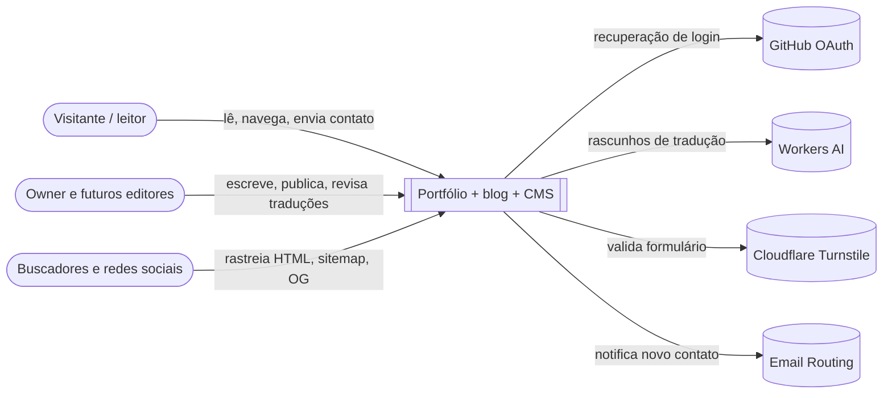
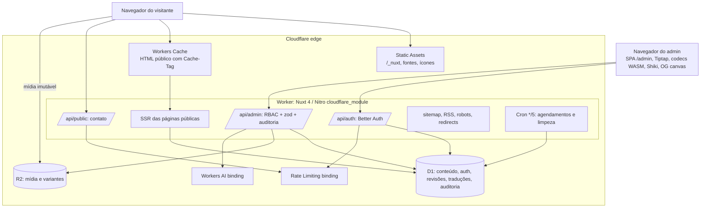
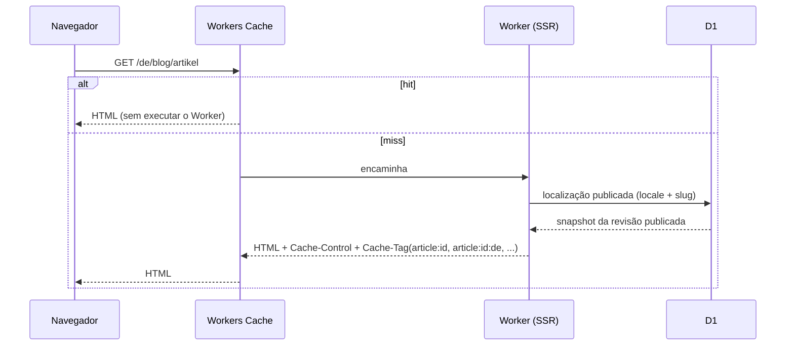
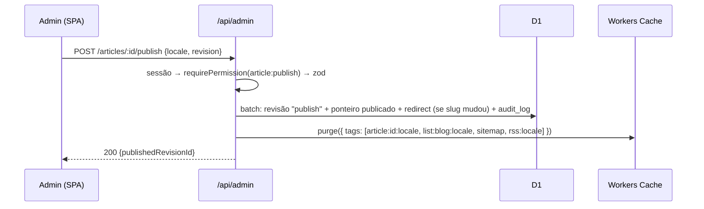
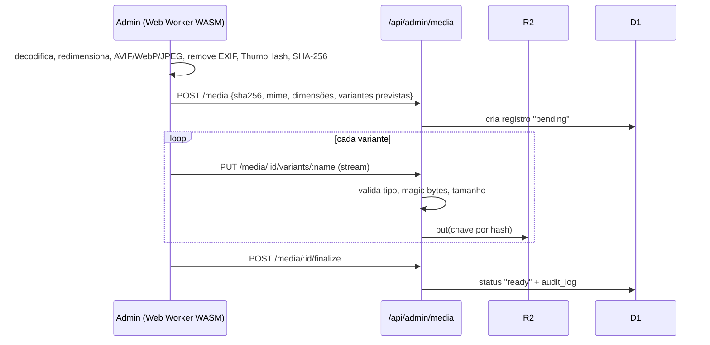
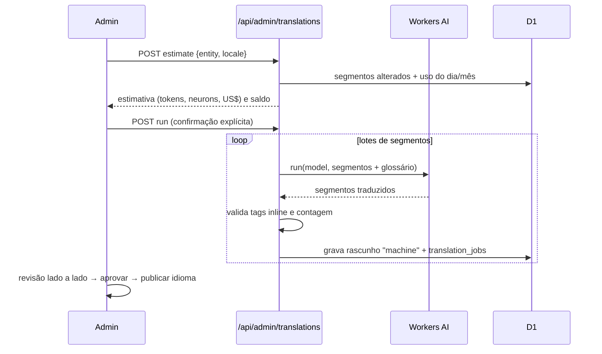

# Arquitetura — visão geral

Monólito Nuxt 4 em um único Worker da Cloudflare: o site público é renderizado no servidor e servido do cache de borda, o admin é uma SPA protegida e todos os dados ficam em D1 (relacional) e R2 (mídia). As decisões estão nos [ADRs](adr/); este documento mostra como as peças se encaixam.

## 1. Contexto (C4 nível 1)



## 2. Containers (C4 nível 2)



## 3. Estrutura do repositório (criada na F00)

```
app/                    # Vue: páginas, componentes, composables (SSR + cliente)
  components/
    ui/                 # primitivos do design system (público)
    layout/             # header, footer, navegação, seletor de idioma
    content/            # renderer do documento (sem Tiptap)
    media/              # ResponsiveImage, Video, Gallery
    motion/             # componentes client-only de animação
    admin/              # SOMENTE admin (proibido importar no público)
  composables/          # usePageSeo, useMotion, ... (admin/ para os do admin)
  layouts/              # default, reading, admin
  middleware/           # admin-auth (UX; a segurança real é no servidor)
  pages/                # rotas públicas + admin/**
  assets/css/main.css   # Tailwind 4 + tokens (@theme)
i18n/locales/           # mensagens de UI: pt-BR, en, es, de, fr
server/
  api/                  # handlers finos: validar → autorizar → serviço → resposta
    public/  auth/  admin/
  routes/               # rss.xml, robots.txt, sitemap source, media proxy (preview)
  middleware/           # sessão do admin, origem/CSRF, redirects, headers
  plugins/              # CSP por hash, Cache-Tag, logging
  tasks/                # tarefas agendadas (Nitro tasks)
  services/<domínio>/   # regras de negócio (*.service.ts) e queries (*.repo.ts)
  db/schema/  db/migrations/  db/seed/
  utils/                # useDb, requirePermission, validação, cache, auditoria
shared/                 # isomórfico: tipos, schemas zod, permissões, locales, design tokens TS
tests/                  # unit/, nuxt/, workers/, api/, e2e/, a11y/
scripts/                # checagem de orçamento de JS, chaves de i18n
```

Regras de dependência entre pastas: [architecture-guardian/references/boundaries.md](../../.claude/skills/architecture-guardian/references/boundaries.md).

## 4. Renderização e cache por rota

| Rota | Modo | Cache | Observações |
|---|---|---|---|
| Páginas públicas (`/`, `/sobre`, listas, detalhes, em todos os idiomas) | SSR | Workers Cache: `Cache-Control` para cache compartilhado longo e navegador curto + `Cache-Tag` (valores finais no F00-T6) | Nunca emitem `Set-Cookie`. Conteúdo completo sem JS |
| `/_nuxt/**`, fontes | Static Assets | `public, max-age=31536000, immutable` | Nomes com hash |
| Mídia (`media.<domínio>` em produção; `/media/**` em preview/local) | R2 | `public, max-age=31536000, immutable` | Chaves endereçadas por conteúdo |
| `/sitemap.xml`, `/rss.xml`, `/robots.txt` | Worker | Como páginas públicas, com tags `sitemap`, `rss:{locale}` | `robots` muda por ambiente |
| `/api/public/**` | Worker | `no-store` | Turnstile + rate limit |
| `/api/auth/**` | Worker (Better Auth) | `no-store` | Rate limit |
| `/api/admin/**` | Worker | `private, no-store` | Sessão + permissão + zod + auditoria |
| `/admin/**` | SPA (`ssr: false`) | `private, no-store`, `X-Robots-Tag: noindex` | Bundle separado do público |
| `/preview/{token}` | SSR | `private, no-store`, `noindex` | Token HMAC de curta duração |

## 5. Fluxos principais

### 5.1 Leitura pública



### 5.2 Publicação e invalidação



### 5.3 Upload de mídia



### 5.4 Tradução assistida



### 5.5 Login

Passkey: `navigator.credentials.get` → Better Auth verifica a assinatura (WebCrypto, CPU baixa) → sessão em D1 com cookie `HttpOnly; Secure; SameSite=Lax`. GitHub OAuth: só IDs na allowlist (`OWNER_GITHUB_ID`) conseguem entrar; serve como recuperação para registrar uma nova passkey.

## 6. Bindings, variáveis e segredos (nomes)

| Tipo | Nome | Uso |
|---|---|---|
| D1 | `DB` | Banco por ambiente (`portfolio-preview`, `portfolio-production`) |
| R2 | `MEDIA` | Mídia por ambiente |
| R2 | `BACKUPS` | Exports semanais do D1 (só produção) |
| Workers AI | `AI` | Tradução |
| Rate limit | `RL_AUTH`, `RL_PUBLIC`, `RL_ADMIN` | Limites por IP/sessão |
| Email | `CONTACT_EMAIL` | `send_email` para o endereço verificado |
| Var | `ENVIRONMENT`, `SITE_URL`, `MEDIA_BASE_URL` | Configuração por ambiente |
| Var pública | `TURNSTILE_SITE_KEY` | Widget do contato |
| Segredo | `BETTER_AUTH_SECRET`, `GITHUB_CLIENT_ID`, `GITHUB_CLIENT_SECRET`, `OWNER_GITHUB_ID`, `BOOTSTRAP_TOKEN`, `PREVIEW_TOKEN_SECRET`, `IP_HASH_SALT`, `TURNSTILE_SECRET_KEY` | Nunca no cliente, nunca em log |
| Segredo (só se usar o fallback de cache) | `CF_API_TOKEN_PURGE` | Purge por tag via API |
| Segredo (futuro, com aprovação) | `ANTHROPIC_API_KEY` | Provedor Claude |

Detalhes por ambiente: [operations/environments.md](../operations/environments.md).

## 7. Decisões

| ADR | Tema |
|---|---|
| [0002](adr/0002-plataforma-e-toolchain.md) | Plataforma e toolchain |
| [0003](adr/0003-renderizacao-cache-e-cpu.md) | Renderização, cache e orçamento de CPU |
| [0004](adr/0004-dados-d1-drizzle.md) | Dados: D1 + Drizzle |
| [0005](adr/0005-autenticacao-e-rbac.md) | Autenticação e RBAC |
| [0006](adr/0006-conteudo-e-editor.md) | Conteúdo e editor |
| [0007](adr/0007-midia.md) | Mídia |
| [0008](adr/0008-i18n-e-seo.md) | i18n e SEO |
| [0009](adr/0009-traducao-assistida-por-ia.md) | Tradução assistida por IA |
| [0010](adr/0010-design-system.md) | Design system |
| [0011](adr/0011-motion.md) | Motion |
| [0012](adr/0012-seguranca.md) | Segurança |
| [0013](adr/0013-testes-e-qualidade.md) | Testes e qualidade |
| [0014](adr/0014-operacao.md) | Operação |
