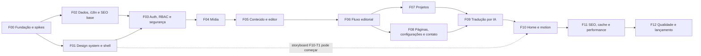

# Roadmap de implementação

13 fases e 59 tarefas pequenas, verificáveis e com dependências explícitas. **Uma tarefa por vez, uma branch e um PR por tarefa.** Cada arquivo de fase traz as tarefas (objetivo, arquivos, critérios de aceite e testes) e termina com o prompt da fase, pronto para colar no Claude Code.

## 1. Fases



| Fase | Arquivo | Gate de saída |
|---|---|---|
| F00 | [F00-fundacao.md](F00-fundacao.md) | ADR-0003 e ADR-0013 com validação preenchida; decisão Free/alternativa tomada por você |
| F01 | [F01-design-system.md](F01-design-system.md) | Direção visual aprovada (design-direction §9) |
| F02 | [F02-dados-i18n-seo.md](F02-dados-i18n-seo.md) | Rotas nos 5 idiomas com head correto; migração inicial aplicada localmente |
| F03 | [F03-auth-rbac-seguranca.md](F03-auth-rbac-seguranca.md) | Matriz de autorização verde e `/security-audit` sem achados altos |
| F04 | [F04-midia.md](F04-midia.md) | Upload → variantes → entrega funcionando de ponta a ponta |
| F05 | [F05-conteudo-editor.md](F05-conteudo-editor.md) | Editor → validação → renderer, sem `@tiptap` no bundle público |
| F06 | [F06-fluxo-editorial.md](F06-fluxo-editorial.md) | J-03, J-04 e J-07 passando em E2E |
| F07 | [F07-projetos.md](F07-projetos.md) | Estudo de caso publicado de ponta a ponta |
| F08 | [F08-paginas-configuracoes-contato.md](F08-paginas-configuracoes-contato.md) | Páginas institucionais e contato funcionando, com notificação |
| F09 | [F09-traducao-ia.md](F09-traducao-ia.md) | J-05 e J-06 passando; teto de custo comprovado por teste |
| F10 | [F10-home-motion.md](F10-home-motion.md) | Storyboard aprovado e implementado dentro do orçamento |
| F11 | [F11-seo-cache-performance.md](F11-seo-cache-performance.md) | Lighthouse dentro da política; purge ≤ 60 s comprovado |
| F12 | [F12-qualidade-lancamento.md](F12-qualidade-lancamento.md) | `/release-check` com "go" e lançamento autorizado por você |

## 2. Status das tarefas

`pendente` → `em andamento` → `concluída` (ou `bloqueada: motivo` / `adiada: motivo`). O status fica na tabela de cada tarefa, no arquivo da fase, e é atualizado pelo Claude Code ao final de cada tarefa.

## 3. Convenções

- **Branch:** `<tipo>/<id>-<slug>`, por exemplo `feat/F03-T2-passkey-github`. Tipos: `feat`, `fix`, `chore`, `docs`, `test`, `refactor`, `perf`.
- **Commits:** Conventional Commits em inglês, por exemplo `feat(auth): add passkey login with GitHub recovery (F03-T2)`. Só quando você pedir.
- **PR:** um por tarefa, com o relatório da [Definition of Done](../quality/definition-of-done.md#3-modelo-de-relatório-de-tarefa) na descrição.
- **Dependência nova:** checklist do `/architecture-guardian` + ADR quando exigido ([ADR-0001](../architecture/adr/0001-registro-de-decisoes.md)).

## 4. Prompt genérico: executar uma tarefa

Os prompts das fases são variações deste. Use-o diretamente quando quiser escolher a tarefa:

```text
Projeto: ~/Desktop/dev/portfolio. Execute a tarefa <ID> (ou, se eu não indicar, a primeira tarefa "pendente" da fase <FXX> com dependências concluídas).

1. Leia CLAUDE.md, o arquivo da fase em docs/roadmap/ e os ADRs/documentos citados na tarefa. Confira o estado real do repositório (git status, arquivos existentes).
2. Antes de editar qualquer arquivo, apresente: objetivo, arquivos que vai criar ou alterar, abordagem, dependências novas (com justificativa), testes que vai escrever e riscos. Aguarde minha aprovação.
3. Implemente somente o escopo aprovado. Não altere funcionalidades não relacionadas nem adicione dependências desnecessárias.
4. Rode `pnpm typecheck`, `pnpm lint` e os testes relevantes. Cole o resumo real da saída; se algo não puder rodar, diga o quê e por quê. Nunca declare testes aprovados sem executá-los.
5. Aplique as skills indicadas na tarefa e verifique segurança, acessibilidade e performance conforme a superfície tocada.
6. Atualize o status da tarefa, os ADRs e os docs afetados.
7. Entregue o relatório no formato da Definition of Done: mudanças, verificação, critérios de aceite, limitações e próximo passo.
8. Não faça commit, push, deploy, migração remota nem crie recursos externos sem eu pedir explicitamente.
```

## 5. Prompt: revisar uma tarefa concluída

```text
Revise a tarefa <ID> no estado atual do repositório (diff contra a main). Não altere código.
Use /architecture-guardian e, conforme a superfície, /security-audit, /performance-audit e /test-engineer.
Confira cada critério de aceite da tarefa com evidência (arquivo:linha ou saída de comando executado agora).
Liste: bloqueadores, problemas importantes, sugestões e o que ficou fora do escopo. Termine com "aprovar" ou "ajustar".
```

## 6. Prompt: retomar uma sessão

```text
Retome o projeto ~/Desktop/dev/portfolio. Leia CLAUDE.md e docs/roadmap/README.md, identifique a fase atual (primeira com tarefas pendentes), resuma em 5 linhas o estado (tarefas concluídas, em andamento e bloqueadas) e proponha a próxima tarefa, sem implementar nada ainda.
```

## 7. Rastreabilidade

A matriz requisito → tarefa está em [docs/README.md](../README.md#rastreabilidade).
